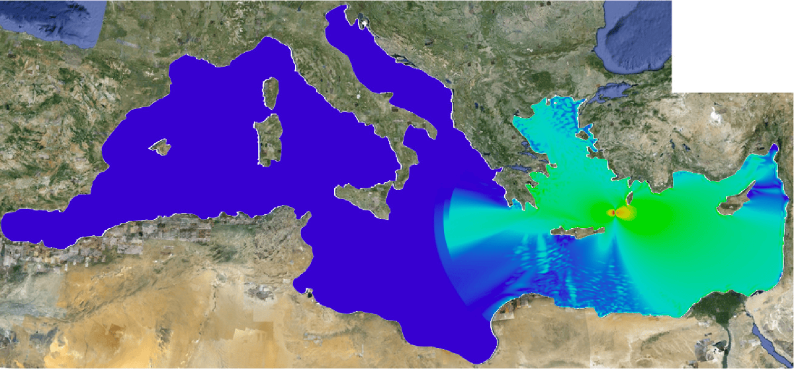

<!-- Author: Dr. Denys Dutykh (Mathematics Department, Khalifa University of Science and Technology, Abu Dhabi, UAE) -->

# TsunamiTutorial: tsunami generation and propagation with a Boussinesq system of BBM type and domain adaptation, in FreeFem++



The graphical abstract of the article cited below (panel (a) of its Figure 12): the largest elevation of the free
surface reached until t = 6800 s by a tsunami computed with the BBM–BBM system over a flat bottom in the Mediterranean
Sea, on the full mesh, from 0 (deep blue) to 0.4 m, drawn over a satellite view of the basin. The largest elevations
lie near the source, in the eastern basin, from which the waves spread along rays; in the western basin they stay close
to zero.

The FreeFem++ scripts of this repository model the generation of a tsunami by an earthquake and its propagation across
the sea, and accompany the tutorial article by Georges Sadaka and Denys Dutykh in Geosciences (2020). They solve a
simplified Boussinesq system of Benjamin–Bona–Mahony type (sBBM), derived by D. Mitsotakis (2009), for the elevation of
the free surface and the horizontal velocity, with continuous piecewise linear (P1) finite elements in space and an
explicit second-order Runge–Kutta scheme in time, over three bottoms of increasing complexity: a flat bottom (a tsunami
in the Mediterranean Sea), a bottom variable in space (the Java tsunami of 2006, generated passively) and a bottom
variable in space and time (the same tsunami, generated actively by the motion of the sea floor). The meshes are built
from a picture of the sea or from bathymetric data, and the domain adaptation technique introduced in the article keeps
the computation on the part of the sea that the waves have reached.

## The problem

Over a flat bottom at the depth h, the system is the BBM–BBM system for the elevation η(x, y, t) of the free surface
above its level at rest and the horizontal velocity V = (u, v):

```text
∂η/∂t − b h² Δ(∂η/∂t) + ∇·((h + η) V) = 0,
∂V/∂t − d h² Δ(∂V/∂t) + g ∇η + ½ ∇|V|² = 0,          b = d = 1/6,
```

where g is the acceleration due to gravity; the coefficients b and d follow from the parameters θ² = 2/3 and μ = ν = 0
of the family of systems, which every script sets near its top. Over a bottom at the depth h(x, y) that moves by
ζ(x, y, t) during an earthquake, the system gains terms in the derivatives of h and ζ: the scripts solve equations (4)
of the article, in which the highest derivatives of h are neglected so that the computation over real bathymetry stays
stable. The displacement of the sea floor is built from Okada's solution for a rectangular fault in an elastic
half-space. In the passive generation, the displacement due to one rectangular fault standing for the whole earthquake
is copied onto the free surface at t = 0. In the active generation, the sea floor moves as the rupture spreads over the 147 subfaults of the 2006 Java earthquake (21 along the
strike, 7 down the dip):

```text
ζ(x, y, t) = Σᵢ H(t − Tᵢ) (1 − exp(−α (t − Tᵢ))) Oᵢ(x, y),        α = ln 3 / τ,    τ = 8 s,
```

where Oᵢ is Okada's solution for the subfault i, H the Heaviside function, τ the rise time and Tᵢ the time at which the
rupture, spreading from the epicentre at 1.1 km/s, reaches the subfault. The domain adaptation starts the computation
on a small part of the mesh around the source and adds to it layers of the full mesh as the waves spread.

## Running the scripts

Each script is run with FreeFem++ from its own folder, with the options given in its header: `-ns` (the script is not
printed) and `-v 0` (FreeFem++ prints no messages); adding `-nw` runs it without the graphics window. The meshes come
first, since the three tsunami scripts read them from `Common_files/`:

```sh
cd Mesh_generation
FreeFem++ mesh_photo_xyz_generate.edp -ns -v 0
```

As shipped (`type="xyz"` at line 43), this script builds the mesh of the sea around Java from the bathymetry
`Common_files/java2006-787.xyz` and writes `Common_files/Java_eps_0.01_alpha_100_Dx_0.03.msh`, in a few seconds. For the
Mediterranean Sea, set `type="photo"` at line 43 and replace `"complex.pgm"` by `"mediterannee.pgm"` at line 56, then
run the script again: it builds the mesh from the picture `mediterannee.pgm` and writes
`Common_files/Mediterannee_eps_1_alpha_1_Dx_1.5.msh`. The other scripts are run in the same way:

| Folder | Command | What it computes |
|---|---|---|
| `Tsunami_Java_Passive/` | `FreeFem++ sBBM_Java_Passive.edp -ns -v 0` | the Java tsunami of 2006 over the real bathymetry, generated passively, up to t = 1750 s with a time step of 1 s |
| `Tsunami_Java_Active/` | `FreeFem++ sBBM_Java_Active.edp -ns -v 0` | the same tsunami generated actively (the sea floor moves during the first 270 s), up to t = 1750 s with a time step of 2 s |
| `Tsunami_Mediterannee/` | `FreeFem++ BBM_FB_Mediterannee.edp -ns -v 0` | a tsunami in the Mediterranean Sea over a flat bottom, up to t = 1000 s with a time step of 0.1 s (the final time `T` is set at line 85; the figures of the article go on to t = 6800 s; the header of the script names the file `BBM_FB_code_Mediterannee.edp`) |
| `Java_bottom_displacement/` | `FreeFem++ zeta_Java_compute_save.edp -ns -v 0` | the motion of the sea floor during the Java earthquake, up to t = 270 s, written to `OkadaSolJava_adapt.txt` and `DispOkadaSolJava_adapt.txt` |
| `Convergence/` | `FreeFem++ sBBM_rate.edp -ns -v 0` | the errors in the L² and H¹ norms and their rates of convergence against an exact solution over a variable bottom, on five meshes of a periodic square up to t = 1, written to `rate_sBBM_RK2.txt` (rows of a LaTeX table) and `rate_sBBM_RK2_Matlab.txt` |

Each tsunami script writes its results into a folder `OUTPUT_<case>/` beside it: `Data_RST-0/` holds the solution in
the formats of Medit and ParaView, the records of the wave gauges (a MATLAB file in `Gnuplot/`) and the files from which
a run can be restarted (the variables `IFrestart` and `filenameRST` at line 57), and `RUNPARAM_RST-0/` keeps a copy of
the scripts that were run. Writing `1` into `OUTPUT_<case>/zz.contd` stops a run cleanly, after it has saved a restart
point. Three variants of the adaptation are offered by the variable `method` of the Mediterranean script: the technique
of the article (`"Adapt_GS"`, the default), the mesh adaptation of FreeFem++ (`"Adapt_FF"`) and no adaptation
(`"Full"`).

## Contents

| Folder or file | Contents |
|---|---|
| `Mesh_generation/` | `mesh_photo_xyz_generate.edp` (the mesh of the sea, from a picture or from bathymetric data, whose coastline is the zero level of a regularised indicator of the sea), the picture `mediterannee.pgm` of the Mediterranean Sea and the test picture `complex.pgm` |
| `Common_files/` | `Common_Macros.idp` (the Runge–Kutta step, the output folders, the restart and the clean stop), `OkadaSol.edp` (Okada's solution), `adapt_GS.edp` (the domain adaptation of the article), `java2006-787.xyz` (the bathymetry around Java: longitude, latitude and elevation in metres) and `ffault_ext.txt` (the 147 subfaults of the 2006 Java earthquake); the meshes are written here |
| `Tsunami_Java_Passive/`, `Tsunami_Java_Active/`, `Tsunami_Mediterannee/` | the three tsunami computations |
| `Java_bottom_displacement/` | the motion of the sea floor during the Java earthquake |
| `Convergence/` | `sBBM_rate.edp` (the convergence test), `sBBM_RHS.edp` (the exact solution and the source terms it requires) and the Maple worksheet `exact_sol_sBBM.mw`, which computes them |
| `GraphicalAbstractSmall.png` | the picture at the top of this page |

## Requirements

FreeFem++, with the plugins it ships (`shell`, `medit`, `iovtk`, `isoline`, `bfstream`, `ppm2rnm`), on Linux or macOS,
since the scripts copy files with `cp`. The installation for every platform is described at
https://doc.freefem.org/introduction/installation.html. The authors tested the scripts with FreeFem++ 4.1; with FreeFem++
4.17 the mesh of the sea around Java is built in a few seconds and the passive Java case runs (its first 90 s of
physical time take about a minute, a time that grows as the waves spread). The worksheet `exact_sol_sBBM.mw` opens in Maple.

## How to cite

If you use these scripts, please cite the article:

G. Sadaka and D. Dutykh, Adaptive numerical modeling of tsunami wave generation and propagation with FreeFem++,
Geosciences 10, 351 (2020).

https://doi.org/10.3390/geosciences10090351

```bibtex
@article{Sadaka2020,
  author = {Sadaka, Georges and Dutykh, Denys},
  title = {Adaptive {{Numerical Modeling}} of {{Tsunami Wave Generation}} and {{Propagation}} with {{FreeFem}}++},
  journal = {Geosciences},
  year = 2020,
  month = sep,
  volume = {10},
  number = {9},
  pages = {351},
  doi = {10.3390/geosciences10090351}
}
```

The button "Cite this repository" in the right-hand column of this page gives the same reference, read from
`CITATION.cff`. The article is in open access on the site of the journal. The scripts themselves are archived on Zenodo:
version 1.1, of 20 August 2020, has the first DOI below, and the second DOI always leads to the latest archived version.

https://doi.org/10.5281/zenodo.3992674

https://doi.org/10.5281/zenodo.3968643

The system solved by the scripts is that of D. E. Mitsotakis, Boussinesq systems in two space dimensions over a variable
bottom for the generation and propagation of tsunami waves, Mathematics and Computers in Simulation 80, 860–873 (2009);
the displacement of the sea floor is computed from Y. Okada, Surface deformation due to shear and tensile faults in a
half-space, Bulletin of the Seismological Society of America 75, 1135–1154 (1985); and the subfaults of the 2006 Java
earthquake are those of D. Dutykh, D. Mitsotakis, X. Gardeil and F. Dias, On the use of the finite fault solution for
tsunami generation problems, Theoretical and Computational Fluid Dynamics 27, 177–199 (2013).

https://doi.org/10.1016/j.matcom.2009.08.029

https://doi.org/10.1785/bssa0750041135

https://doi.org/10.1007/s00162-011-0252-8

## Licence

GNU General Public License, version 3 or (at your option) any later version, as the headers of the scripts state (see
`LICENSE`). Until November 2026 the file `LICENSE` held the text of the GNU Lesser General Public License, version 2.1,
which no script names; the archives of versions 1.0 and 1.1 on Zenodo still contain that file. The bathymetry
`java2006-787.xyz` was downloaded from the National Oceanic and Atmospheric Administration (NOAA) of the United States.

## Authors

Georges Sadaka (Laboratoire de Mathématiques Raphaël Salem, Université de Rouen Normandie) and Denys Dutykh
(Mathematics Department, Khalifa University of Science and Technology, Abu Dhabi, UAE).

https://gsadaka.perso.math.cnrs.fr/

https://www.denys-dutykh.com/
